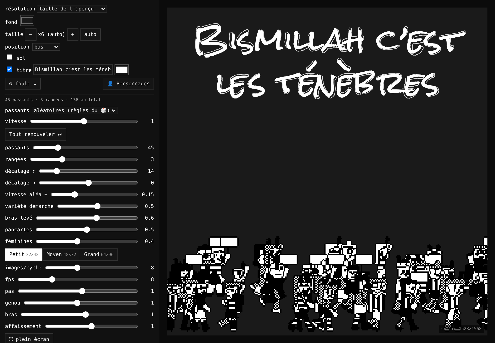
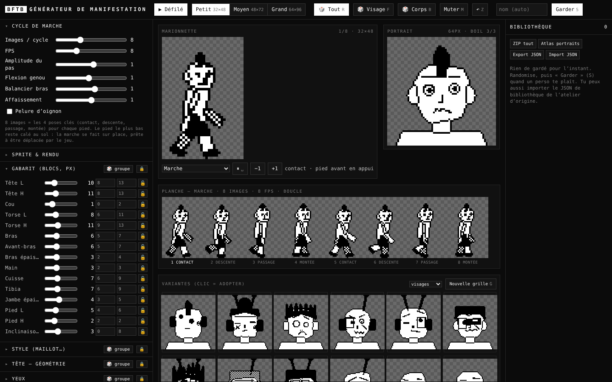

**English** · [Français](README.fr.md)

# Générateur de manifestation — generative 1-bit protest crowd

A generative, procedural animation tool that fills the screen with a crowd of 1-bit pixel-art characters marching from left to right. Every marcher is unique: face, body, outfit, gait and gestures are all generated from rules and a seeded random generator. Some wave an arm, some hold a blank sign.

It is a single HTML file with no build step and no dependencies to install. It runs in any modern browser, on desktop or phone.

It renders in pure black and white, and every character can be exported as a sprite sheet ready to be sliced in a game engine or an animation program.

> 🔗 **Live demo:** https://guillaumiemartin-lgtm.github.io/generateur-manifestation/

## Screenshots

**Crowd page** on a landscape tablet: settings on the left, preview on the right.



**Characters page** on a computer: settings on the left, previews in the middle, library on the right.



## Two pages

The interface is in French.

| Page | What it does |
|---|---|
| **Défilé** (crowd, home page) | The march. On a phone: full screen, with the settings in a transparent bar at the bottom. On a landscape tablet or a computer: settings on the left, preview on the right. |
| **Personnages** (characters) | The character editor: settings on the left, previews on the right (stacked on a phone). Open it with « 👤 Personnages », come back with « ▶ Défilé ». |

Only one page runs at a time: the march pauses while you edit characters, and picks up where it left off when you come back.

## Crowd page (home page)

- Full-screen march, with a background colour of your choice and a shaky hand-scribbled title at the top. The title is editable; by default it reads « Bismillah c'est les ténèbres ».
- **Lossless integer scaling** (×1, ×2, ×3…). In auto mode the crowd fills about a third of the picture height.
- **Output resolution** (landscape tablet and computer): the size of the preview area, 1920×1080, 1280×720, 4K, 1080×1920 vertical, 1080×1350, 1080×1080, or a custom size. When the resolution is larger than the screen, only the **preview** is scaled down (the percentage is shown). Image and video exports keep the full resolution. On a phone, the output resolution is the screen itself, in physical pixels.
- A transparent **settings bar** at the bottom:
  - **always visible:** background, display size (− / + / auto), position, ground lines, title, « ⚙ foule » (show or hide the crowd block), « 👤 Personnages »;
  - **crowd block:**
    - marcher source (random, from the library, or the current character), speed;
    - number of marchers (1–200), rows (1–8), vertical and horizontal row offset;
    - random cadence, **gait variety**, share of raised arms, share of signs, share of feminine silhouettes;
    - character size **Small / Medium / Large** (32×48, 48×72, 64×96 px), walk-cycle settings (frames, fps, stride, knee bend, arm swing, bob);
    - real browser fullscreen;
  - **⇩ Télécharger** (download) at the bottom of the crowd block, with its export scale (×1 to ×4);
  - **📷 Image** (PNG of the whole scene) and **● Vidéo** (5 to 60 s, MP4 or WebM depending on the browser), both at the output resolution.
- On a phone, the bar can be **folded** down to a single slider (number of marchers). On a large screen the settings panel stays open on the left.
- **Smooth transitions:**
  - fewer marchers: the crowd thins out over several walk cycles, because people who exit are simply not replaced;
  - more marchers: newcomers join from the left;
  - row offsets glide to their new values;
  - renewing the whole crowd uses a 1-bit dithered cross-fade (ordered Bayer 4×4).

### What « Télécharger » gives you

A ZIP named `manifestation_<n>_passants.zip` containing, for **every marcher visible on screen**:

- `passant_<nr>_<name>_<anim>.gif`: one full walk cycle as a looping **animated GIF**, black and white on a transparent background, at that marcher's own speed;
- `passant_<nr>_<name>_<anim>.png`: the same frames side by side, as a **sprite strip** for a game or an animation program;

plus a `manifeste.json` listing each marcher's animation, fps, speed factor, horizontal advance per cycle (so feet stay planted if you move it elsewhere) and full parameters.

## Characters page

- Character editor. Every parameter has a current value, a min/max range for the 🎲 randomiser, and a lock.
  - Generative heads (irregular superellipses), eyes, nose, eyebrows, mouth, cyber extras (implants, antennas, crests…).
  - Body template, outfit, standard or feminine silhouette (skirt, narrow waist, long hair).
- Three animations: **walk**, **walk + waving arm**, **walk + sign** (a blank sign on a stick).
- Live preview with onion skin, named frames (contact, down, passing, up), variant grid, mutations.
- Library of kept characters (JSON import and export).
- Per-character export:
  - a sprite sheet with one row per animation;
  - a boiling portrait (3 frames);
  - JSON metadata for slicing the sheet in a game.

## How it works

The tool is generative and procedural: you never draw a character, you set rules and ranges, and the system produces endless variations.

- **Heads**: superellipse polygons (round to square), distorted by seeded noise, with a 3-frame *boil* (line tremble).
- **Walk**: periodic Catmull-Rom interpolation between classic animation key poses. Limbs are solved with trigonometry. Each marcher's speed is computed from its own stride length so the supporting foot doesn't slide.
- **Gait variety**: each marcher gets fixed random draws that modulate stride, knee bend, arm swing, bob and arm-wave rhythm around the shared settings. Wave beats stay whole numbers per cycle, so loops stay seamless.
- **Rendering**: custom 1-bit rasteriser (ink / paper / transparent), with an outer outline and seams between body parts.
- **Scene**: one canvas at the output resolution, composed of the background, the crowd (drawn in sprite pixels then scaled up without smoothing) and the title. The video is recorded straight from that canvas with `MediaRecorder`.
- **GIF encoder and ZIP writer**: written in-page with no library (LZW GIF with 1-bit colour, transparency and infinite loop; uncompressed ZIP with CRC-32). The GIFs were checked pixel by pixel against a reference decoder, and the ZIPs with `unzip -t`.

## Run locally

No installation. Either:

- open `index.html` directly in a browser, or
- serve the folder (recommended, so the web font loads everywhere):

  ```bash
  python3 -m http.server 8000
  # then open http://localhost:8000
  ```

## Publish with GitHub Pages

1. Push this repository to GitHub. GitHub Pages is free for public repositories.
2. Go to **Settings → Pages**.
3. Under **Source**, choose **Deploy from a branch**, then branch `main` and folder `/ (root)`.
4. After a minute, the tool is online at `https://<your-username>.github.io/<repo-name>/`.

### On a phone

- **Android and desktop:** the « ⛶ plein écran » button switches the browser to real fullscreen.
- **iPhone:** Safari does not allow real fullscreen for a web page. Instead, use **Share → Add to Home Screen**. The page declares itself as a web app, so it then opens from the home screen without Safari's bars, under the name « Manif ».
- With many marchers in Large size, older phones may slow down. Lower the number of marchers or use Small.

## Data and privacy

Everything runs in your browser. Settings and the character library are stored in your browser's `localStorage`, and nothing is sent to a server. Each visitor has their own library; nothing is shared. The only external request is the **Rock Salt** web font from Google Fonts, used for the scribbled title. Without a connection, the title falls back to a local cursive font.

## Project structure

```
index.html     the whole tool (HTML + CSS + JavaScript)
docs/          screenshots used in the README
README.md      this file (English)
README.fr.md   French version
LICENSE        MIT licence
```

## Credits

- Design and direction: **Martin Guillaumie**.
- Font: [Rock Salt](https://fonts.google.com/specimen/Rock+Salt) by Sideshow (Font Diner), loaded from Google Fonts. It is released under the Apache License 2.0 and is not included in this repository. Rock Salt is a trademark of Font Diner, Inc DBA Sideshow.

## Licence

The code is released under the [MIT Licence](LICENSE) © 2026 Martin Guillaumie.
